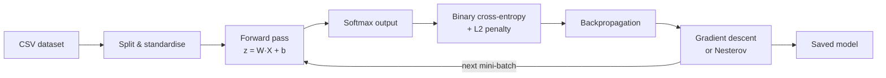

<div align="center">

# Multilayer Perceptron

**A neural network built from scratch in Python and NumPy, no ML framework, to classify breast tumours as malignant or benign.**


</div>

---

## Overview

This project implements a **multilayer perceptron (MLP)** end to end: data split, training, prediction and model comparison, all driven from a single command-line tool. Forward propagation, backpropagation, the loss and the optimisers are written by hand with NumPy matrices. Libraries are only used for data loading (pandas), plots (matplotlib, seaborn) and the confusion matrix (scikit-learn).

The model is trained on the **Wisconsin Diagnostic Breast Cancer** dataset: 569 samples, 30 numerical features computed from cell nuclei images, and a binary label (`M` malignant, `B` benign).

| Feature | Details |
|---|---|
| **Architecture** | Input layer → 2 configurable hidden layers (**ReLU**) → **softmax** output |
| **Training** | Mini-batch gradient descent, backpropagation |
| **Optimiser** | Plain gradient descent or **Nesterov momentum** |
| **Regularisation** | **L2** weight penalty and **early stopping** with patience |
| **Loss** | Binary cross-entropy |
| **Outputs** | Learning curves, predictions CSV, confusion matrix, model comparison plots |

---

## Results

With the default hyperparameters (layers `8, 8`, learning rate `0.001`, batch size `8`, L2 `0.0025`), the model reaches **about 98% accuracy on the test set** (95 to 98% across random splits), with a binary cross-entropy loss around **0.05 to 0.07**.

---

## Setup

```sh
source ./virtualenv.sh              # create the virtualenv and install dependencies
source ./virtualenv.sh --deactivate # remove it
```

Dependencies: `pandas`, `matplotlib`, `seaborn`, `scikit-learn` (see `requirements.txt`).

---

## Quick start

```sh
python3 -B main.py split            # 1. split datasets/data.csv into train.csv and test.csv
python3 -B main.py train -m         # 2. train the model and show metrics
python3 -B main.py predict          # 3. evaluate it on the test set
```

---

## Commands

<details>
<summary><b>split</b> - split the dataset into training and testing sets</summary>

```sh
python3 -B main.py split [-r RATIO] [-d DATA_PATH]
```

| Option | Description | Default |
|---|---|---|
| `-r`, `--ratio` | Share of the data kept for training | `0.7` |
| `-d`, `--data_path` | CSV file to split | `datasets/data.csv` |

</details>

<details>
<summary><b>train</b> - train the multilayer perceptron</summary>

```sh
python3 -B main.py train [-d DATA_PATH] [-l LAYERS] [-eta LR] [-e EPOCHS] [-bs BATCH]
                         [-r L2] [-es] [-p PATIENCE] [-n] [-mo MOMENTUM] [-m]
```

| Option | Description | Default |
|---|---|---|
| `-d`, `--data_path` | Training set | `datasets/train.csv` |
| `-l`, `--layers_size` | Size of the 2 hidden layers | `8, 8` |
| `-eta`, `--learning_rate` | Learning rate | `0.001` |
| `-e`, `--epochs` | Number of epochs | `84` |
| `-bs`, `--batch_size` | Mini-batch size | `8` |
| `-r`, `--regulation` | L2 regularisation strength | `0.0025` |
| `-es`, `--early_stopping` | Enable early stopping | off |
| `-p`, `--patience` | Early stopping patience (epochs) | `4` |
| `-n`, `--nesterov` | Enable Nesterov momentum | off |
| `-mo`, `--momentum` | Momentum coefficient | `0.9` |
| `-m`, `--metrics` | Show detailed metrics during and after training | off |

Saves the model to `train/model.npz`, the scaler to `train/scaler.pkl` and the learning curves to `train/plot.png`.

</details>

<details>
<summary><b>predict</b> - evaluate the trained model</summary>

```sh
python3 -B main.py predict [-d DATA_PATH] [-cm]
```

| Option | Description | Default |
|---|---|---|
| `-d`, `--data_path` | Testing set | `datasets/test.csv` |
| `-cm`, `--confusion_matrix` | Also save the confusion matrix | off |

Saves predictions to `predict/predictions.csv`.

</details>

<details>
<summary><b>compare</b> - compare several models</summary>

```sh
python3 -B main.py compare [-dt DATA_TRAIN_PATH] [-dp DATA_PREDICT_PATH] [-t] [-p]
```

| Option | Description |
|---|---|
| `-dt`, `--data_train_path` | Dataset used for the training comparison |
| `-dp`, `--data_predict_path` | Dataset used for the prediction comparison |
| `-t`, `--train_only` | Compare training only |
| `-p`, `--predict_only` | Compare predictions only |

Plots are saved in `compare/`.

</details>

<details>
<summary><b>clean</b> - remove generated files</summary>

```sh
python3 -B main.py clean [-t] [-p] [-c] [-d]
```

| Option | Removes |
|---|---|
| `-t`, `--train` | `train/` |
| `-p`, `--predict` | `predict/` |
| `-c`, `--compare` | `compare/` |
| `-d`, `--datasets` | generated `train.csv` and `test.csv` |

</details>

---

## How it works



<details>
<summary><b>The maths behind it</b></summary>

**Forward propagation**: each layer computes `z = W · X + b`, then `a = activation(z)`. Hidden layers use ReLU, and the output layer uses softmax so the two class probabilities sum to 1.

**Loss**: binary cross-entropy,
`BCE = -1/N Σ [ yᵢ · log(ŷᵢ) + (1 - yᵢ) · log(1 - ŷᵢ) ]`,
plus an L2 penalty `λ · Σ W²` that discourages large weights.

**Backpropagation**: the gradient of the loss is propagated backward, layer by layer, to get `∇J(θ)` for every weight and bias.

**Gradient descent**: `θ ← θ - η · ∇J(θ)`.

**Nesterov momentum**: looks ahead before computing the gradient, which converges faster and overshoots less:
1. `θ_lookahead = θ + μ · v(t-1)`
2. `v(t) = μ · v(t-1) - η · ∇J(θ_lookahead)`
3. `θ ← θ + v(t)`

**Early stopping**: training stops when the validation loss has not improved for `patience` epochs, to limit overfitting.

</details>

---

## Project structure

```
MultilayerPerception_42/
├── main.py                 # CLI entry point
├── sources/
│   ├── split.py            # dataset split
│   ├── train.py            # training command
│   ├── predict.py          # prediction command
│   ├── compare.py          # model comparison
│   ├── clean.py            # cleanup
│   └── utils/
│       ├── class_utils.py  # Dataset and MLP classes: forward, backprop, optimisers
│       ├── data_utils.py   # standardisation, activations, metrics
│       ├── parse_utils.py  # command-line parsing
│       └── ...
├── datasets/data.csv       # Wisconsin breast cancer dataset
└── virtualenv.sh
```

---

<div align="center">

Made by **Melody BOY** · 42 Nice · [GitHub](https://github.com/mboy29)

</div>
